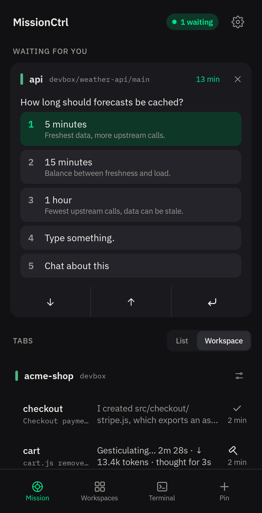
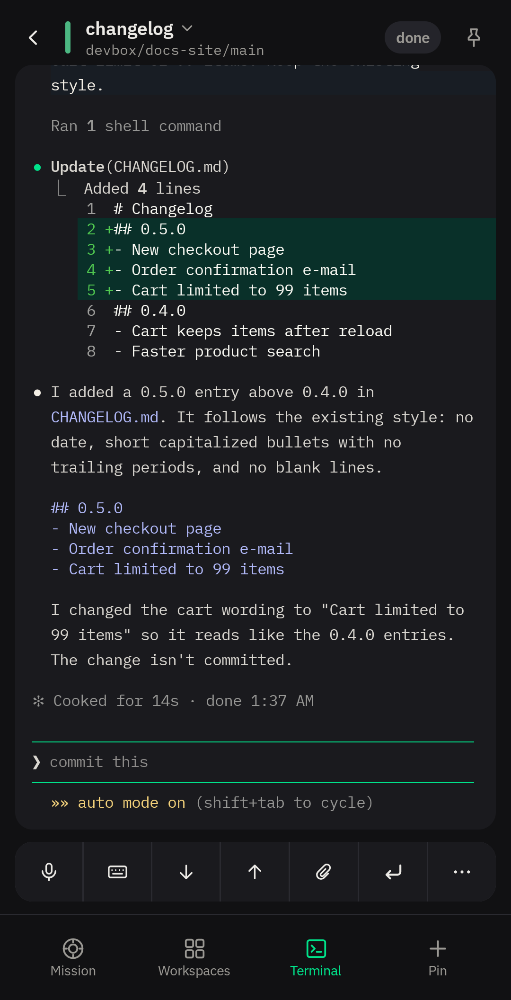
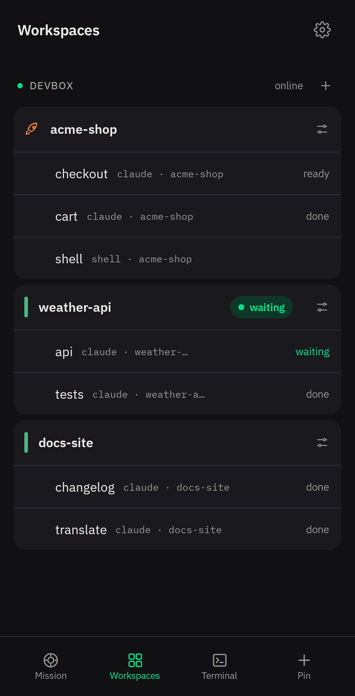
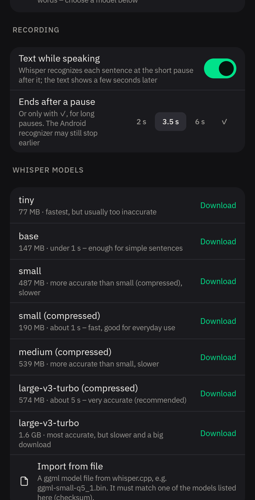
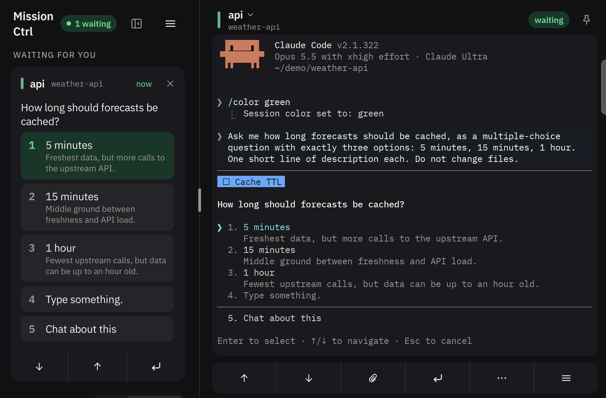

<p align="center">
  
</p>

<h1 align="center">MissionCtrl for herdr</h1>

<p align="center">
  Manage your herdr sessions on the go: answer AI agents and work in any shell.
</p>

<p align="center">
  <a href="https://github.com/rogertobler/missionctrl/releases/latest"></a>
</p>

<p align="center">
  <a href="LICENSE"></a>
</p>

<p align="center">
  
  
  
  
</p>

<p align="center">
  <sub>Answer a waiting agent · work in a pane · workspaces and tabs · dictation with Whisper</sub>
</p>

<p align="center">
  
</p>

<p align="center">
  <sub>On a tablet, an unfolded foldable or a phone in landscape: the list on the left, the open pane beside it</sub>
</p>

MissionCtrl lets you manage your [herdr](https://github.com/herdrdev/herdr) sessions from your
phone, on several servers at once. The panes may run AI agents or plain shells: you see what
your agents are doing, answer when one of them needs you, and work in any pane as a real terminal.

All a server needs is a running herdr and SSH access. The app talks to herdr's Unix sockets
directly over SSH; nothing is installed on the server. It works with the herdr TUI, the classic
terminal app with its own server.

MissionCtrl is an independent project. It is not made, maintained or endorsed by the herdr
project; "herdr" here only names the software the app works with.

## Features

- **One list for everything:** the workspaces, tabs and panes of several servers, and the state
  of each agent: working, done or waiting
- **Answer a waiting agent:** tap a menu option, type or dictate
- **A real terminal:** read a pane's coloured history, or use the pane as a terminal (TUI),
  whether it runs an agent or a plain shell
- **A key bar** for what a phone keyboard lacks (arrows, Esc, Tab, Shift+Tab, Home/End,
  PgUp/PgDn, Del and more), with Ctrl, Alt and Shift to combine
- **Images and files:** paste images and upload files to the server
- **Tabs and workspaces:** create, move and close them
- **Notifications** when an agent is waiting or done, or when a connection drops; with the app
  closed too if you let it stay connected in the background. No push service is involved, and
  you can answer from the notification
- **Dictation on the device** with a local Whisper model (whisper.cpp) or Android's on-device
  recognition (Android 12 and later, where the device offers it); the audio stays on the phone
- **Servers and SSH keys:** several of each; create an Ed25519 key in the app or import one
  (OpenSSH, PEM, PuTTY), or log in with a password. Private keys are encrypted with the Android
  Keystore, with optional fingerprint, face or device PIN on top
- **Large screens:** on a tablet, an unfolded foldable or a phone in landscape, the list sits on
  the left and the open pane beside it
- **Demo mode** with sample agents, to try the app without a server

Android first; an iOS app (SwiftUI) will follow.

## Install

**[Download the APK from GitHub Releases](https://github.com/rogertobler/missionctrl/releases/latest)**
and open it on your phone. It is free; the GPL allows it.

A Google Play version is coming soon. It will cost a little, and buying it supports further
development. Both contain the same code and are signed with the same key, so you can switch
between them without reinstalling.

To check an APK, compare the SHA-256 fingerprint of its signing certificate:

```bash
apksigner verify --print-certs missionctrl.apk
```

```text
Signer #1 certificate SHA-256 digest: 1b23eb879d416965e6912d24df38b5e6a9c0c8815b00bb29687a836c41127391
```

Requirements:

- your own server with herdr and SSH access
- Android 10 or later, 64-bit (arm64)

## Getting started

1. Open the app and tap "Add server": enter the host and the user name.
2. Create a new SSH key (Ed25519) in the app, or import one you already have. Password login
   works too.
3. For a new key, the app shows its public part. Add it to `~/.ssh/authorized_keys` on the server.
4. Connect and confirm the server's host key. Your workspaces, tabs and panes appear in the list.

No server at hand? Tap "Try the demo", or turn on "Demo mode" in the settings, to try the app
with sample agents.

## Feedback

This is the first public release, so your feedback is especially welcome.

- **Bugs and concrete feature requests:**
  [GitHub Issues](https://github.com/rogertobler/missionctrl/issues)
- **Questions, ideas and experiences** (how it works for you, which agents you run, on which
  device): [GitHub Discussions](https://github.com/rogertobler/missionctrl/discussions)

For security problems, please see [SECURITY.md](SECURITY.md) instead.

## Privacy

MissionCtrl collects no data. The app contains no analytics, tracking, crash reporting or
advertising libraries, does not use Google Play Services and talks to no one but the servers you
add yourself. The one exception: if you use Whisper, the chosen speech model is downloaded from
huggingface.co when you tap to download it. App data is excluded from Android backup (Google
Drive, device transfer). The keyboard does not learn from answers, and the fonts ship with the
app.

Speech recognition: "On device" (Android 12 and later, where available) and Whisper keep the
audio on the phone. If you choose another installed recognition service, its privacy terms apply;
some send the audio to their provider. The app points this out when you choose one.

## SSH keys

MissionCtrl does not create a key by itself. When you add your first server, or under
Settings › SSH keys, you create a new key (Ed25519) or import one you already have (OpenSSH, PEM
or PuTTY, from the clipboard or a file, also with a passphrase). The app shows the public part
of a new key; it goes into `~/.ssh/authorized_keys` on the server.

Private keys are stored encrypted with a key from the Android Keystore and are never backed up.
A key can additionally be protected with biometrics or the device PIN; the app then asks for it
before it connects. A key can be exported as a file protected with a passphrase.

## Languages

The app is available in English (the default) and German. Choose under Settings › Language
("System" follows Android's language), or from Android 13 on in Android's app settings.

A further language needs just one file: copy `android/app/src/main/res/values/strings.xml` to
`values-xx/strings.xml` (`xx` = language code, e.g. `values-fr`) and translate the texts. Leave
out entries with `translatable="false"`. The build adds the language to the list by itself.

## Uploaded files

Pasted images and uploaded files are stored on the server under `~/.cache/missionctrl/uploads/`
(readable only by your own user), and their path goes into the input. Cleaning up is up to you.

## Development

### Layout

```text
core/                     Rust core (Cargo workspace)
  crates/mc-core/         SSH, herdr socket API, one runtime per server, several servers together
  crates/mc-cli/          developer tool `mc` to test against real servers
  crates/mc-ffi/          UniFFI interface for Kotlin (and later Swift)
  crates/mc-voice/        speech recognition on the device with whisper.cpp
  crates/uniffi-bindgen/  generates the Kotlin bindings
  hosts.example.json      template for the server list of `mc`
android/                  Android app (Gradle, Jetpack Compose)
```

### Build and test

Requires Rust (stable).

```bash
cd core
cargo build
cargo test
```

The `mc` tool reads its server list from `~/.config/missionctrl/hosts.json`
(template: `core/hosts.example.json`):

```bash
./target/debug/mc hosts              # configured servers
./target/debug/mc ping <host>        # herdr version and socket
./target/debug/mc watch              # live view of all servers and agents
```

### Android build

Requires JDK 17+, the Android SDK (platform 37), the Android NDK, CMake, `cargo-ndk` and the Rust
target `aarch64-linux-android`. The Gradle build builds the Rust core and the bindings itself; it
finds the NDK through `ANDROID_NDK_HOME`.

```bash
cd android
echo "sdk.dir=$HOME/Android/Sdk" > local.properties
./gradlew assembleDebug
adb install -r app/build/outputs/apk/debug/app-debug.apk
```

The app runs on Android 10 and later (arm64).

## Third-party software

Every library, font and speech model is listed with its licence in the app under
Settings › About › Open-source licenses. The list
(`android/app/src/main/assets/licenses/third_party.json`) is regenerated from the Rust and Gradle
dependencies with `python3 android/scripts/third_party_licenses.py` when they change. The fonts
IBM Plex Sans and IBM Plex Mono are licensed under the SIL Open Font License 1.1.

## Licence

© 2026 Inscribe GmbH. MissionCtrl is free software under the GNU General Public License,
version 3 or (at your option) any later version (`GPL-3.0-or-later`). The full text is in
[LICENSE](LICENSE).

The versions in the app stores (Google Play soon, later the App Store) are published by
Inscribe GmbH. They cost a little but contain the same code; buying them supports further
development.

## Contributing

Bug reports, ideas and pull requests are welcome. Contributions are subject to the terms in
[CONTRIBUTING.md](CONTRIBUTING.md): they are licensed under the GPL, and Inscribe GmbH may also
use them in the store versions.

To report a security problem, please see [SECURITY.md](SECURITY.md) instead of opening an issue.
